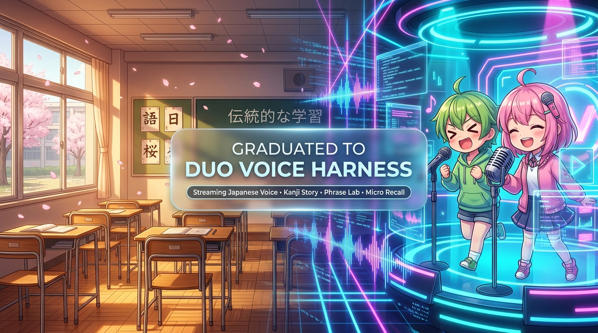
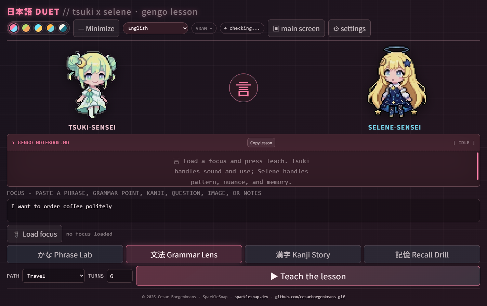

# Gengo Duet

<p align="center">
  <a href="https://github.com/cesarborgenkrans-gif/duo-voice-harness">
    
  </a>
</p>

> [!IMPORTANT]
> ### 🌸 Japanese Gengo Duet has graduated into [Duo Voice Harness](https://github.com/cesarborgenkrans-gif/duo-voice-harness)
> 
> **The two-teacher Japanese language learning loop from Gengo Duet is now fully integrated into [Duo Voice Harness](https://github.com/cesarborgenkrans-gif/duo-voice-harness).**
>
> The experimental lesson prompts from this dashboard have been refined into native, zero-friction pedagogy buttons:
> * 🏮 **Kanji Story:** Vivi teaches the radical story and memory anchor; Momotamu models readings and speakable sentences.
> * 🍵 **Phrase Lab:** Momotamu demonstrates pronunciation and politeness levels; Vivi details nuance and cultural caveats.
> * ⚡ **Micro Recall:** Interactive rapid-fire Japanese recall drills with spaced answers.
>
> **Upgrades in Duo Voice Harness:**
> * 🎧 **Production-Ready Local Voice:** No more experimental ROCm driver crashes; robust multi-packet continuous resampling and audio buffering.
> * 🎙️ **Japanese Speech Clones:** High-fidelity native Japanese reference conditioning.
> * 💬 **Listener Direction:** Toggle seamlessly between companions speaking with you or conversing between themselves.
>
> 👉 **[Start learning with Duo Voice Harness →](https://github.com/cesarborgenkrans-gif/duo-voice-harness)**

<p align="center">
  
</p>

```text
 /\_/\   /\_/\
( ^.^ ) ( o.o )   GENGO DUET
 > ^ <   > ^ <    two teachers, one tiny classroom
```

Gengo Duet is a compact Electron classroom where Tsuki-sensei and
Selene-sensei teach Japanese together. One OpenAI-compatible model plays both
teachers over a shared lesson transcript: Tsuki makes the material speakable;
Selene makes its grammar, kanji, and nuance easier to remember.

**Gengo Duet is a side-screen app by design.** When a secondary display is
connected, the app starts there and fills that screen. The main-screen control
can move it temporarily; if only one display is available, Gengo Duet opens on
that display instead.

## Download or run from source

Windows users can download the portable app from the
[latest GitHub release](https://github.com/cesarborgenkrans-gif/side-screen-gengo-duet/releases/latest).
The portable build does not need an installer. For the intended tiny-classroom
layout, connect the secondary screen before launching the app.

> **Release safety note:** v1.0.1 replaces the original v1.0.0 portable build
> with the memory guardrails described below. Use v1.0.1 or newer when loading
> local models through Gengo Duet.

To run from source:

```bash
npm install
npm start
```

For a normal resizable development window, run `npm run dev`.

## What it does

- Starts from a daily seed, pasted text, a file path, or an image for a
  vision-capable model.
- Offers Phrase Lab, Grammar Lens, Kanji Story, and Recall Drill lesson modes.
- Includes Starter, JLPT N5, Travel, Daily Life, and Creative Reading paths.
- Keeps both teachers on one transcript so each turn can build on the last.
- Supports 18 interface and explanation languages.
- Can speak each turn through an optional local
  [VoiceGen Oui](https://github.com/cesarborgenkrans-gif/VoiceGen-Oui-ROCm-VoxCPM2)
  server.
- Remains fully usable as a text classroom when voice is unavailable.

## Connect a model

Gengo Duet needs an OpenAI-compatible chat endpoint. It includes presets for:

- LM Studio at `http://localhost:1234/v1`
- Ollama at `http://localhost:11434/v1`
- OpenRouter at `https://openrouter.ai/api/v1`
- another compatible custom endpoint

Open settings in the app, choose a provider and model, and add an API key only
when the provider requires one. Image lessons require a vision-capable model.
VoiceGen Oui is optional and defaults to `http://localhost:3113`.

For LM Studio, Gengo Duet never chooses or loads a model automatically. Its
large Settings view lists downloaded models, checks current VRAM and RAM, and
locks the load action when the selected model is above the computer's safe
memory limit or the required measurements are unavailable. A model that is
already running in LM Studio can be used without loading another copy.

Local LM Studio, Ollama, and VoiceGen use keeps lesson material on your machine.
A cloud endpoint receives the text or image you submit and may charge for API
calls.

## Verify and package

```bash
npm run check
npm run dist:win
```

The packaged app uses an explicit runtime allowlist. Local display data, QA
material, icon experiments, logs, secrets, dependencies, and build output are
not included in source control or the portable release.

Translations are maintained as a durable source library and exported into
`locales/`. See [TRANSLATION.md](TRANSLATION.md) for the runtime boundary.

## Credits

- Concept, design, and development: Cesar Borgenkrans / SparkleSnap.
- Teaching mascots: Tsuki-sensei and Selene-sensei.
- Optional local voice add-on: VoiceGen Oui.
- Made with a little AI pair-programming help from Claude Opus 4.8-senpai and
  OpenAI Codex — thank you, senpais! 🌙✨

## License

The software code is available under the [MIT License](LICENSE).

SparkleSnap branding, character designs, official artwork, sprites, logotypes,
and creative copy are not included in the code license. Friendly
non-commercial fan works are welcome with credit; see
[ASSET_LICENSE.md](ASSET_LICENSE.md) for the boundary.

## Support me

If you would like to support my tiny tools and future experiments,
[follow SparkleSnap on Pinterest](https://se.pinterest.com/sparklesnapper/) 🏡✨
